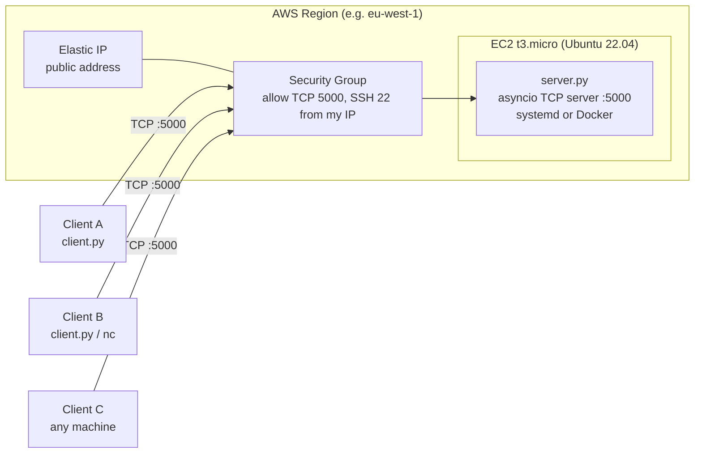

# TCP Multi-User Chat (CSC 423)

Real-time group + private chat built on raw **TCP sockets** (Python 3.10+ standard library only, no dependencies, no secrets).

## Features
- Server accepts many concurrent clients (asyncio, one TCP connection each)
- Unique usernames (2–20 chars: letters, digits, `_`, `-`)
- Group chat and one-to-one messages (`/msg bob hello`)
- Join/leave notifications, `/users`, clean `/quit`, abrupt-disconnect handling
- Message format: **newline-delimited JSON** (one JSON object per line)

## Protocol
| Direction | Message |
|---|---|
| C→S | `{"type":"join","username":"alice"}` (must be first) |
| C→S | `{"type":"msg","text":"hi"}` · `{"type":"private","to":"bob","text":"hi"}` · `{"type":"users"}` · `{"type":"quit"}` |
| S→C | `joined`, `msg`, `private`, `system`, `users`, `error` |

TCP is a byte stream with no message boundaries, so `\n` is the frame delimiter; max frame 4096 bytes.

## Run locally
```bash
python server.py                       # listens on 0.0.0.0:5000 (CHAT_HOST / CHAT_PORT env vars override)
python client.py 127.0.0.1 5000 alice  # terminal 2
python client.py 127.0.0.1 5000 bob    # terminal 3
```
Client commands: plain text = group message, `/msg <user> <text>`, `/users`, `/quit`.
Any raw TCP tool also works: `nc <host> 5000` then type `{"type":"join","username":"carol"}`.

## Test
```bash
python -m unittest discover -s tests -v     # 4 tests: group/private, duplicate name, disconnect, bad JSON
python udp_experiment.py                    # optional UDP loss/reorder comparison
```

## Architecture

No database: state (connected users) lives in server memory. Cloud services: **EC2** (VM running the server), **Security Group** (virtual firewall opening TCP 5000), **Elastic IP** (stable public address), optional **CloudWatch** for logs.

## Deploy on AWS EC2
1. EC2 → Launch instance: Ubuntu 22.04, `t3.micro` (free tier), create/download a key pair (**keep the `.pem` out of Git**).
2. Security group inbound rules: **Custom TCP 5000 from 0.0.0.0/0** (chat), **SSH 22 from your IP only**.
3. (Recommended) Allocate an **Elastic IP** and associate it with the instance.
4. SSH in and run:
```bash
ssh -i key.pem ubuntu@<ELASTIC_IP>
sudo apt update && sudo apt install -y python3 git
git clone <your-repo-url> tcp-chat && cd tcp-chat
python3 server.py            # quick test; Ctrl+C to stop
```
5. Keep it running with systemd — `/etc/systemd/system/chat.service`:
```ini
[Unit]
Description=TCP Chat Server
After=network.target
[Service]
WorkingDirectory=/home/ubuntu/tcp-chat
ExecStart=/usr/bin/python3 -u server.py
Restart=always
User=ubuntu
[Install]
WantedBy=multi-user.target
```
```bash
sudo systemctl daemon-reload && sudo systemctl enable --now chat && sudo systemctl status chat
journalctl -u chat -f        # live logs
```
*Docker alternative:* `docker build -t chat . && docker run -d -p 5000:5000 --restart always chat`
6. From two different machines: `python client.py <ELASTIC_IP> 5000 alice` and `... bob`.

**Connection details to submit:** `<ELASTIC_IP>:5000` (TCP). Test reachability: `nc -vz <ELASTIC_IP> 5000`.

## Evidence checklist
- [ ] Screenshot: EC2 instance running + security group rules
- [ ] Screenshot: `systemctl status chat` / server logs showing 2+ users joined
- [ ] Screenshots or video of two clients chatting at the same time (group + `/msg`)
- [ ] Screenshot of a client quitting and others seeing "left the chat"

## Security
No keys/passwords in the repo (`.gitignore` blocks `.pem`, `.key`, `.env`). Messages are plaintext TCP (no TLS) — acceptable for the assignment; production would wrap in TLS.
